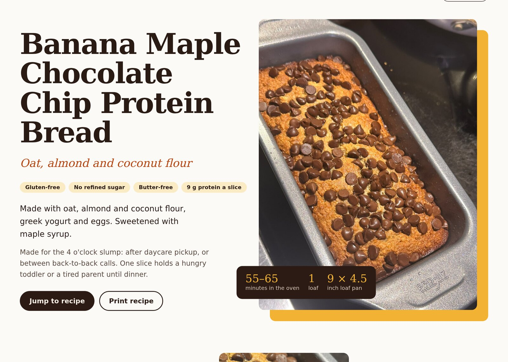
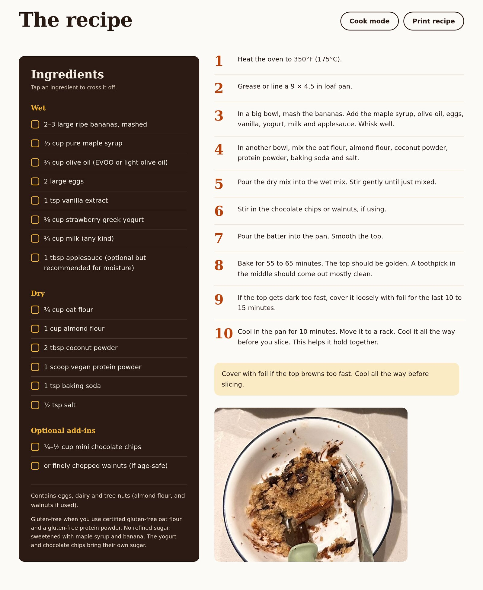
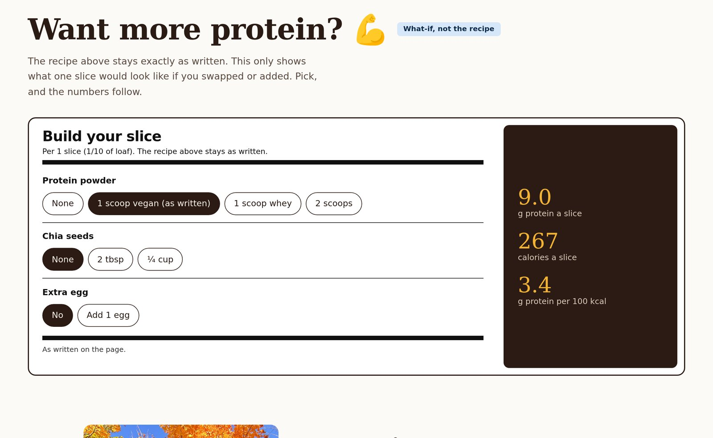
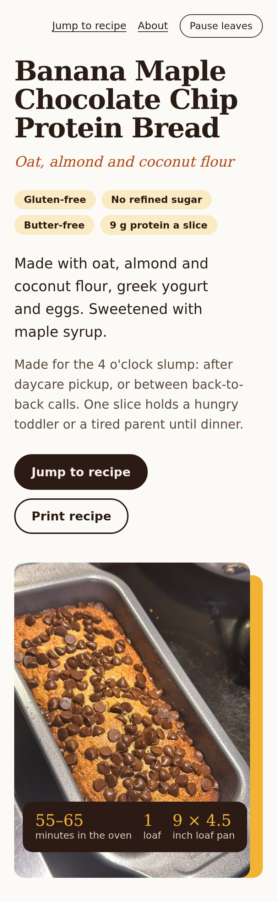
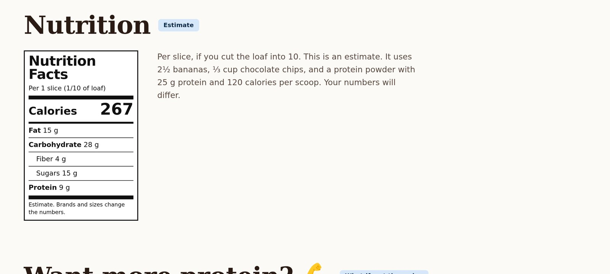

# yummy-food

Simple food that works for real life. A one-page recipe site, hand-written in plain HTML, CSS and
JavaScript, published with GitHub Pages.

**Live:** https://aditiabhang.github.io/yummy-food/

  

## The recipe

Banana Maple Chocolate Chip Protein Bread. Oat, almond and coconut flour, greek yogurt, eggs,
maple syrup, one scoop of protein powder. Gluten-free, butter-free, no refined sugar, 9 g protein a
slice. One bowl for wet, one for dry, 55 to 65 minutes in the oven.

The page is built to be used in a kitchen, not just read:

- **Tick-off ingredient list.** Tap an ingredient to cross it out as you gather it.
- **Cook mode.** Keeps the phone screen awake while you bake (on browsers that support it).
- **Print recipe.** A clean print layout with the ingredients and method only.
- **Nutrition label.** A classic Nutrition Facts panel for one slice.
- **Protein builder.** A what-if card: swap the powder for whey, add chia or an extra egg, and see
  the protein and calories per slice change. The written recipe never changes.

  

  

  
  &nbsp;&nbsp;
  

## How it is built

- One `index.html` with the styles and the small amount of JavaScript inline. No framework, no
  build step, no package manager. What is committed is what GitHub Pages serves.
- Fonts (Literata) are self-hosted under `assets/fonts/`. Photos are my own, in `assets/images/`,
  stripped of EXIF and GPS data.
- Recipe structured data (`schema.org/Recipe` JSON-LD) so search engines can show the recipe card.
- Works at phone and desktop widths, respects `prefers-reduced-motion`, and prints cleanly.

## Tracking (the nerdy part)

I run this site like a tiny experiment. Analytics are [Umami Cloud](https://umami.is): one script
tag, no cookies, no personal data, nothing stored in the browser. Visits are counted, and a handful
of named events show which parts of the page people actually use:

| Event             | Fires when                                              | Extra data                 |
| ----------------- | ------------------------------------------------------- | -------------------------- |
| `jump-to-recipe`  | the "Jump to recipe" button is pressed                  | place: header or hero      |
| `print-recipe`    | the "Print recipe" button is pressed                    | place: hero or recipe      |
| `recipe-card`     | anything inside the recipe section is tapped, e.g. an ingredient is ticked | |
| `protein-builder` | an option in the protein builder is picked              | pick, e.g. `powder-whey`   |
| `outbound-link`   | an Instagram link is followed                           | place: about or nerd-line  |

Nothing runs on `localhost`, and there are no other trackers.

Want to see the numbers or swap ideas? [DM me on Instagram](https://www.instagram.com/mi_aditi/).
